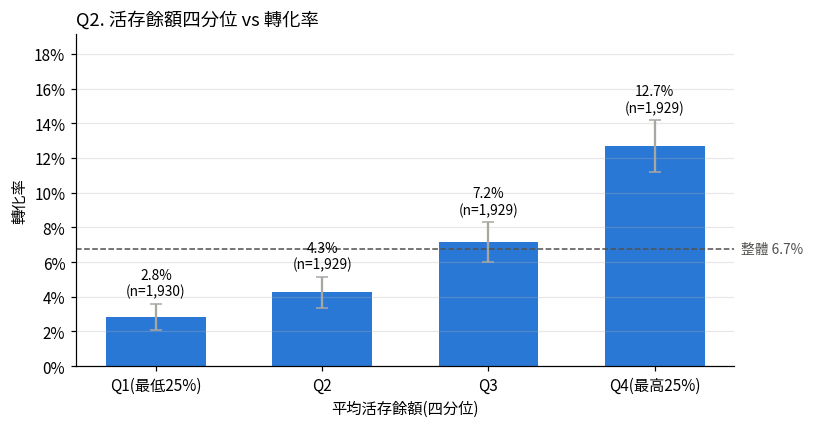
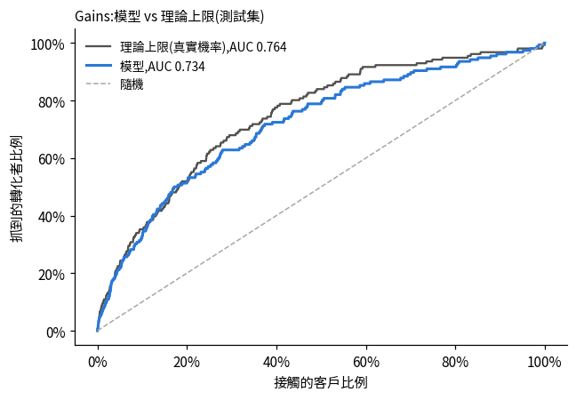
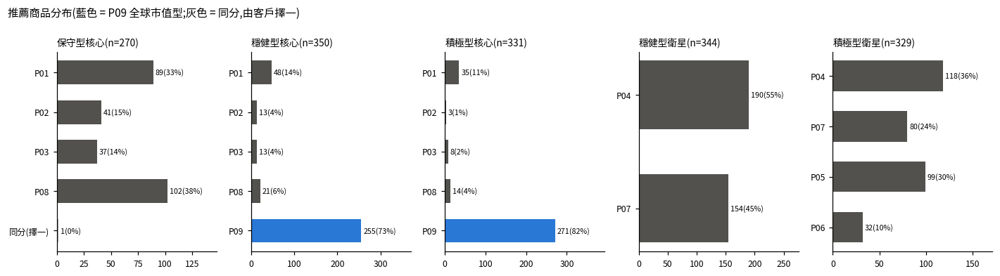

# 客戶定期定額投資轉化推薦系統

> 以金控為情境：在行銷資源有限的前提下，找出該優先接觸哪些尚未理財的存款戶與卡戶、推薦什麼樣的定期定額組合，以及如何驗證這個策略能提升手續費收入。

**Summary**

Using simulated data for 9,000 bank customers, this project ranks non-investing deposit and credit-card customers by their expected fee value for starting a regular investment plan (SIP) in funds or ETFs, then recommends a KYC-compliant core–satellite portfolio to each. Contacting the top 20% of eligible customers (951 people) reaches 47% of customers who convert, 2.36 times the efficiency of a random list (out-of-fold evaluation). All 951 recommendations pass the KYC compliance check. Because the labels represent conversion without marketing, the incremental effect of marketing is framed as a scenario and left to an A/B test.

---

## 重點結果

- 接觸可推薦客戶中期望價值最高的 20%（951 人），可以找到 **47.2%** 的轉化客戶，名單轉化率 19.2%，是隨機名單的 **2.36 倍**。這是用 out-of-fold 分數實測的結果，這裡的轉化是沒有行銷介入的自然轉化。
- 951 位客戶都拿到符合自己 KYC 等級的核心＋衛星定期定額組合，合規率 **100%**。
- 行銷每讓轉化率相對提升 10%，第一年約新增 **18 位**轉化客戶、**2.5 萬元**手續費和 **188 萬元** AUM 流入。提升幅度是情境假設，實際數字要用 A/B 測試量測。

---

## 1. 商業問題與專案定位

**商業問題**：在行銷資源有限、且不消耗金控自有資本的前提下，面對持有信用卡或活存、但尚未理財的既有客戶，應該優先接觸誰、推薦什麼，以及如何驗證這個策略能提升財富管理與投信的手續費收入？

**專案定位**：本專案使用模擬資料，所以不宣稱證明「未理財客戶有投資需求」。轉化標籤是依設定的公式產生的，模型學到的規律，只是重現了資料生成時的設定。本專案展示的是不依賴這個假設的部分：資源有限時怎麼排出優先接觸的名單、做出符合 KYC 規範的推薦與配置邏輯，以及設計驗證核心假設的實驗（A/B 測試）。因為不是真實資料，所有分析結論都加上「在模擬資料中……」，不寫成對真實客戶的發現。

---

## 2. 流程


| 階段 | 回答的問題 | 輸出 |
| --- | --- | --- |
| 資料清洗 | 資料可以信任嗎？ | 清洗後的 5 張表 |
| EDA | 哪些客戶特徵和轉化有關？ | 8 個問題的發現 |
| 轉化傾向模型 | 每位客戶開始定期定額的機率？ | 轉化機率 |
| 期望價值排序 | 考慮收入後，該優先接觸誰？ | 接觸名單 951 人 |
| 內容過濾推薦 | 該推薦什麼組合、扣多少？ | 每人的核心＋衛星配置 |
| KPI 量化試算 | 換算成多少效率與收入？ | 三層 KPI |

---

## 3. 資料

模擬 9,000 位客戶的資料，共 5 張表：客戶主檔、逐月活存餘額（12 個月）、逐月信用卡消費（6 個月，10 個消費類別）、逐月 App 理財瀏覽紀錄（6 個月）和理財商品目錄（9 檔），另外有一張轉化標籤表。

特徵只用 2026/08 以前的資料，標籤是 2026/09–2026/11 這三個月內有沒有開始定期定額。兩段時間分開，避免模型用到未來的資訊。

分析對象是還沒有持有理財商品的 7,717 人，轉化率 6.7%。其中先保留 3 個月緊急預備金之後，可投資閒置資金還有 12,000 元以上（一年扣得起最低月扣款 1,000 元）的 4,755 人，是可以推薦的客戶。

資料是用 LLM 協助設計的程式產生的，分布參考 BankChurners 等公開資料集，並刻意放入缺值、重複列、哨兵值等髒資料，讓清洗步驟有實際的問題可以處理。

---

## 4. 各階段的方法與結果

### 4.1 資料清洗（[01_資料清洗.ipynb](01_資料清洗.ipynb)）

把客戶主檔從 9,045 列整理成 9,000 人，處理 `unknown`、`-`、`N/A`、`999999` 這類哨兵值、不一致的日期格式、負餘額和缺值。

去重時一開始用整列比對，漏掉了 42 組重複的消費紀錄：每組裡有一筆金額是哨兵值，整列看起來就不一樣。後來改用「客戶 × 月份 × 消費類別」判斷是否重複，才全部找出來。

### 4.2 EDA（[02_EDA.ipynb](02_EDA.ipynb)）

設計了 8 個問題，每個問題都對應後面的一個決策，看結果之前先寫下預期。

活存餘額最高的 25% 客戶，轉化率是最低 25% 的 4.5 倍（12.7% vs 2.8%）。收入一開始看起來也有關係，但在相同的餘額水準下比較，就看不出收入的影響了，所以模型沒有放收入。消費類別和 App 上最常點的理財標籤有中強度的關聯（Cramér's V = 0.44），不過只集中在 3C、母嬰、旅遊三類，後來設定推薦權重時有參考這個結果。



### 4.3 轉化傾向模型（[03_轉化傾向模型.ipynb](03_轉化傾向模型.ipynb)）

用邏輯迴歸，放了 9 個依業務假設設計的特徵，訓練集和測試集以 70:30 分層抽樣切分。選邏輯迴歸是因為業務端除了名單，也會想知道客戶為什麼會轉化，係數可以直接解釋。

測試集的 AUC 是 0.734，PR-AUC 0.221（大約是隨機的 3.3 倍），分數最高的 20% 涵蓋了 51% 的轉化者。因為資料是模擬的，可以用標籤真正的生成機率，算出同一份測試集的 AUC 上限 0.764。以超過隨機的部分來算，模型大約做到上限的 89%，而且沒有超過上限，所以沒有看到資料洩漏的跡象。

顯著的特徵有活存餘額、餘額成長率、App 點擊、往來年資滿 5 年和積極型 KYC。



### 4.4 期望價值排序（[04_期望價值排序.ipynb](04_期望價值排序.ipynb)）

期望價值 = 轉化機率 × 每位轉化客戶的年手續費。用它排序，名單會偏向「會轉化、扣款金額也比較高」的客戶，和手續費收入的目標一致。評估時用 out-of-fold 分數，每位客戶的分數都來自沒看過他的模型。

和只看轉化機率的排序相比，兩份名單抓到的轉化者一樣是 183 人，期望價值名單中實際轉化者的預估手續費多了 10.1%。轉化者只有 183 人，也沒有做統計檢定，這個差距只能當作方向參考。兩份名單有 73.9% 重疊，換掉的 248 人大致是從「機率較高、月扣款約 3,000 元」換成「機率中等、月扣款約 10,000 元」。

### 4.5 內容過濾推薦（[05_內容過濾推薦.ipynb](05_內容過濾推薦.ipynb)）

先依 KYC 等級排除客戶不能買的商品，再用客戶在各消費類別的占比和商品權重表算 cosine 相似度，分別挑出核心和衛星商品。金額依風險屬性分配：保守型全部放核心，穩健型 80:20，積極型 70:30。

1,627 檔推薦（同分時列出的商品也算在內）全部符合客戶的 KYC 等級，9 檔商品都有被推薦到。推薦結果和權重表的設計一致，例如保守型的母嬰客戶大多拿到美債基金，旅遊客戶的衛星幾乎都是旅遊消費主題基金。

穩健型和積極型的核心大多是全球市值型 ETF（73%、82%）。核心本來就是用來分散、長期持有的部分，所以我接受這個結果，代價是核心推薦比較沒有個人化。



### 4.6 KPI 量化試算（[06_KPI量化試算.ipynb](06_KPI量化試算.ipynb)）

分成三層：A 層用實際標籤衡量名單效率，B 層用假設推估收入，C 層是上線後用來驗證 B 層假設的 A/B 測試。

| 層 | 結果 | 性質 |
| --- | --- | --- |
| A | 接觸 951 人，期望價值名單有 183 位轉化，隨機名單的期望值是 77.6 位；Lift 2.36，捕獲率 47.2% | 實測 |
| B | 依推薦商品計算，每人年手續費 1,360 元；行銷每讓轉化率相對提升 10%，新增 18.3 人、手續費約 2.5 萬元、第一年 AUM 流入約 188 萬元 | 假設 |
| C | 把名單隨機分成接觸組和保留組，兩組轉化率的差距就是行銷實際帶來的效果 | 上線後執行 |

比較意外的是，積極型客戶帶來的手續費最低，每人 947 元，保守型則是 2,173 元。積極型的核心大多是費率低的 ETF，保守型不能買全球市值型 ETF，核心大多是基金。如果全部用同一種費率計算，三種 KYC 幾乎沒有差別，可見這個差距來自推薦的商品。

---

## 5. 關鍵決策紀錄

| 決策 | 原因 |
| --- | --- |
| 不放收入 | EDA 顯示控制餘額之後，收入沒有獨立影響；模型放與不放收入的 AUC 幾乎一樣（0.714 vs 0.716），收入係數 p = 0.56，所以不放收入 |
| 年資改為「≥ 5 年」旗標 | 分組轉化率呈現台階式關係（4–5 年 4.4% → 5–6 年 9.4%），連續年資不顯著；改為旗標後顯著（勝算比 1.57）。AUC 幾乎不變，這個改動改善的是對結果的解讀，排序能力不變 |
| 不用 SMOTE 或 class_weight | 目的是排序與計算期望價值，不是分類。實測兩種方法的排序能力都沒有提升（AUC 0.731～0.733，不處理為 0.734），平均預測機率卻從 6.6% 被拉高到約 43%，期望價值會灌水約 6.5 倍。見 [03_轉化傾向模型.ipynb](03_轉化傾向模型.ipynb) 第 7.3 節 |
| 用 VIF 檢查共線性 | 相關係數只看兩兩配對，VIF 能抓到多個特徵合起來造成的共線性；所有 VIF 都低於 1.3 |
| 月扣款規則改為「可投資閒置資金 ≥ 12,000 元才推薦、無條件捨去」 | 原本的規則把不足 1,000 元的月扣款拉到 1,000 元，並四捨五入到千元，結果 53.1% 的可推薦客戶一年的扣款會超過可投資閒置資金，和「先保留緊急預備金」的前提矛盾，所以改成閒置資金至少要能扣滿一年才推薦 |
| 核心與衛星嚴格遵守比例、不取整；衛星不足 1,000 元時只配置核心 | 比例是依 KYC 等級設定的，取整會讓比例偏離（例如 7,000 元變成 86:14）；衛星低於每檔最低扣款時無法配置，改為只配置核心，並告訴客戶月扣款增加到多少可以加入衛星 |
| 用 out-of-fold 分數評估名單 | 訓練集客戶的分數是「模型看過答案」的分數；OOF 讓 4,755 位可推薦客戶都能用來評估 |
| 採用期望價值排序 | 目標是手續費收入；轉化人數相同，預估手續費較高。風險（月扣款推估錯誤）只影響被替換的 248 人 |
| 同分時列出 KYC 允許的全部候選 | 資料不足時不替客戶判斷，也不往高風險商品推薦 |
| 收入情境用 10%／20%／30% 三個情境 | 行銷提升幅度沒有資料依據；公式是線性的，所以先呈現「每提升 10%」的影響，實際值交給 A/B 測試 |

---

## 6. 如何確保結果正確

**AI 協作方式**

| 角色 | 負責的工作 |
| --- | --- |
| Claude | 設計模擬資料（參考真實資料集的分布，並刻意加入髒資料讓我練習清理）；討論專案設計方向 |
| Claude Code | 撰寫 EDA 之後的程式 |
| 我 | 定義商業問題、撰寫資料清洗程式、設計專案邏輯、制定決策與驗證結果（例如商品權重、核心與衛星的比例）、給出 Insight |

**怎麼確認 AI 產出的結果是正確的**

我把工作分給多個對話，依功能讓每個 AI 負責不同任務，避免單一對話太長、前後不一致，再讓它們互相核對產出的結果。最後我會檢查規則之間有沒有邏輯漏洞、數字是否合理、模型表現有沒有異常，確保最後產出的結果是正確且解釋得通的。下表是實際發現的問題：

| 問題或檢查項目 | 怎麼發現的 | 處理方式 |
| --- | --- | --- |
| 月扣款規則和「先保留緊急預備金」互相矛盾：不足 1,000 元拉到 1,000 元、四捨五入進位，使 53.1% 的可推薦客戶一年扣款超過可投資閒置資金 | 檢查規則之間是否一致，再用資料確認影響範圍 | 改為「可投資閒置資金 ≥ 12,000 元才推薦」並無條件捨去，違反人數降為 0 |
| 匯出的客戶主檔有 9,045 列（應為 9,000） | 檢查最終輸出，而不只看每個步驟的輸出 | 補回遺漏的程式並重新執行，匯出前加上唯一性檢查 |
| 刷卡金額把美元當成新台幣，每月刷卡中位數只有 355 元 | 檢查金額分布是否符合常理 | 修改生成程式並重新產生資料，確認標籤與髒資料位置不變 |
| 兩次計算的 SMOTE 結果不一致（AUC 0.731 vs 0.663） | 兩個對話各自獨立計算，結果對不上 | 追查後發現其中一次先合成樣本才標準化，距離幾乎只由年齡決定；改成先標準化再合成，兩邊一致。結論（不用 SMOTE）不變 |
| 模型的 AUC 是否「好到不合理」 | 找回生成程式，算出同一份測試集的理論 AUC 上限 | 模型 0.734 < 上限 0.764，沒有發現資料洩漏的跡象 |

另外：

- 每份 notebook 都用 `assert` 檢查關鍵條件（例如列數、合規率 100%、月扣款不超過可投資閒置資金）。
- 期望價值排序、內容過濾、KPI 的關鍵數字，都由兩次獨立計算互相對照，結果一致。

---

## 7. 限制與下一步

- 核心假設未經驗證：標籤是沒有行銷介入的自然轉化，模型找得到「會轉化的人」，但無法證明「行銷有效」。下一步是以 A/B 測試量測行銷的真實增量。
- 模擬資料：分布參考國外資料集，不一定反映台灣金融市場；點擊行為也是模擬的，所以推薦權重只能說「參考了模擬資料中的瀏覽行為」。
- 沒有購買紀錄與扣款資料：無法評估推薦準不準；月扣款、手續費都依假設推估（假設集中於[計畫書](專案計畫書.md)附錄 A）。
- 收入只算第一年、是毛收入：低估定期定額的長期價值，也沒有扣除接觸成本。
- 推薦的個人化程度：核心推薦大多是全球市值型 ETF；權重約半數依業務直覺設定。

完整的限制與假設見[專案計畫書](專案計畫書.md)第 6 節與附錄 A。

---

## 8. 專案結構與執行方式

```
├── README.md
├── 專案計畫書.md              # 完整的設計、假設、限制
├── requirements.txt           # 套件版本
├── 01_資料清洗.ipynb
├── 02_EDA.ipynb
├── 03_轉化傾向模型.ipynb
├── 04_期望價值排序.ipynb
├── 05_內容過濾推薦.ipynb
├── 06_KPI量化試算.ipynb
├── data_raw/                  # 原始模擬資料（含髒資料）
├── data_cleaned/              # 清洗後的資料
├── outputs/                   # 模型評分、接觸名單、推薦結果
├── data_generation/           # 模擬資料的生成程式（只用來對答案，分析 notebook 不 import）
└── images/                    # README 用的圖片
```

**執行方式**：依編號順序執行 notebook（02 EDA 可以獨立執行）。在 Google Colab 執行時，第一個 code cell 會自動安裝中文字型；在本機執行前，先用 `pip install -r requirements.txt` 安裝套件。

**執行環境**：Google Colab（Python 3.13）

| 套件 | 版本 |
| --- | --- |
| pandas | 2.2.3 |
| NumPy | 2.1.3 |
| scikit-learn | 1.6.1 |
| statsmodels | 0.15.0 |
| SciPy | 1.16.3 |
| Matplotlib | 3.10.0 |
| imbalanced-learn | 0.14.2 |

---

## 作者

- 姓名：黎光耀
- Email：a36901031@gmail.com
- LinkedIn：https://www.linkedin.com/in/kuang-yao-li-156397169/
